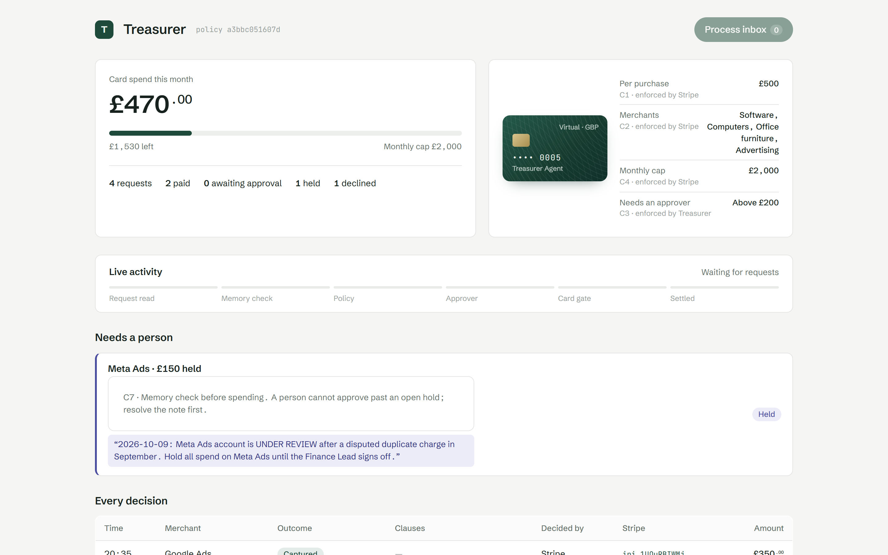
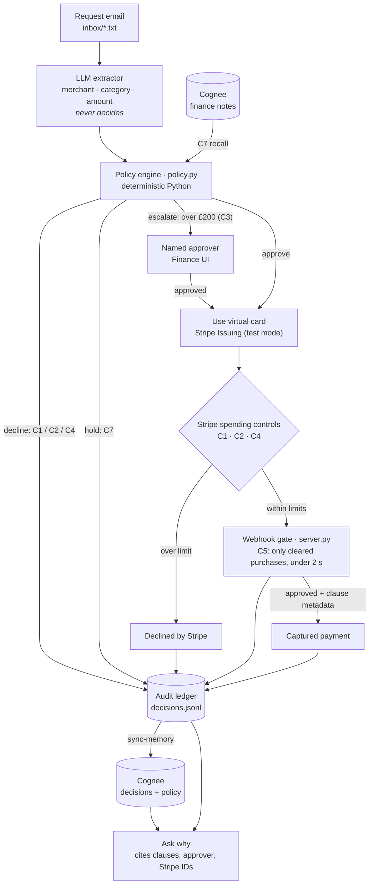
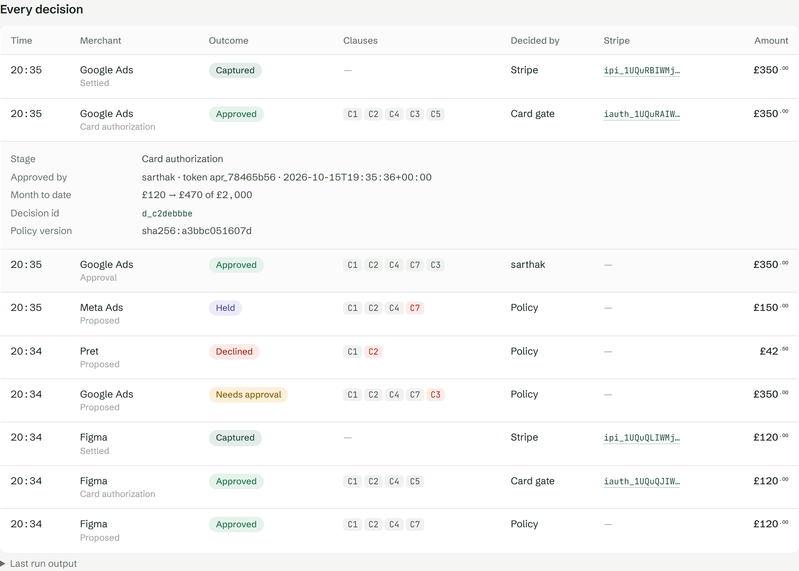
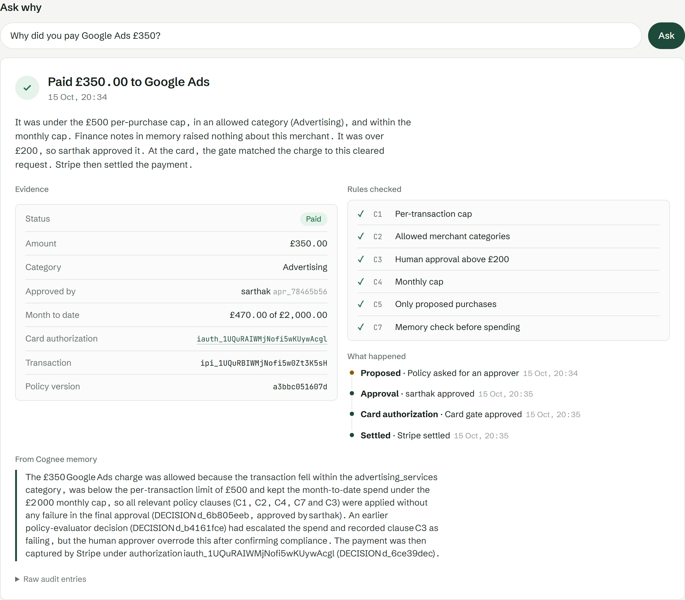

# Treasurer — a buying agent that can only spend what the policy says

Briefcase × Stripe hackathon, London, 15 Oct 2026 · Track 01 "Agents that spend". Stripe **test mode** only.

**The LLM reads the request. Memory is consulted. A deterministic policy decides. Stripe is the final gate.**

Treasurer reads purchase requests from an inbox, checks them against a written policy, and pays with a
Stripe Issuing virtual card. Every decision records which clauses applied, and you can ask "why did you
pay X?" afterwards.



## How it works



- **Deterministic policy.** Plain Python in `policy.py` makes every decision; the LLM only reads emails.
- **Guardrails in the network.** C1, C2 and C4 are also set on the card itself, so Stripe enforces them even if our code is down.
- **Fails closed.** If the memory lookup fails, the purchase is held.
- **Explains every pound.** Clause IDs, decision ID and approver go into the Stripe authorization's metadata and the ledger.

## Screenshots

**Every decision, with its evidence.** Each row shows the clauses checked. Click a row to see the approver, month-to-date spend and Stripe IDs.



**Ask why.** The answer is built from the audit trail and from Cognee memory, and cites the clauses, the approver and the Stripe authorization.



## The policy (`policy.yaml`)

| Clause | Rule |
|---|---|
| C1 | No single purchase over £500 |
| C2 | Only software, computer equipment, office furniture and advertising |
| C3 | Over £200 needs a named approver |
| C4 | No more than £2,000 a month |
| C5 | The card may only be charged for a purchase the agent proposed and the policy cleared |
| C6 | Every decision records its clauses and evidence |
| C7 | Hold if the finance notes in Cognee flag the merchant (hold, dispute, under review…) |

## Run it

Needs Python 3.10+, a UK Stripe account in test mode with Issuing enabled and the Issuing balance funded,
the [Stripe CLI](https://docs.stripe.com/stripe-cli), an OpenAI key and Cognee Cloud.

```bash
cp .env.example .env            # fill in the keys
pip install -r requirements.txt
python setup_stripe.py          # creates the cardholder and the policy-limited card
python agent.py ingest-notes    # loads the finance notes into Cognee (once)

# two terminals
python -m uvicorn server:app --port 8000
stripe listen --events issuing_authorization.request,issuing_authorization.created,issuing_transaction.created \
              --forward-to localhost:8000/stripe/webhook     # put the printed whsec_... in .env
```

Open **http://localhost:8000/** and click **Process inbox**. Approve escalations by name, and ask *why* about any payment.
The CLI does the same: `python agent.py inbox`, `approve`, `execute`, `sync-memory`, `why "..."`.

Check that it's deterministic: `python replay.py --expect 8552ceded9b0ced2`.

For a hosted version, see [docs/heroku.md](docs/heroku.md).

## Repo layout

| Path | What |
|---|---|
| `agent.py` | inbox → propose → approve → pay; `why` |
| `server.py` | Stripe authorization webhook (answers within 2 s) and the finance UI |
| `policy.py`, `policy.yaml` | the rules |
| `extractor.py` | LLM: email → fields |
| `recall.py`, `memory.py`, `notes/` | Cognee memory (C7 and "why") |
| `ledger.py`, `ledger/` | append-only audit trail |
| `inbox/` | demo requests (`inbox/later/` has more test cases) |
| `fallback_connect/` | earlier design: contractor payouts via Stripe Connect |
